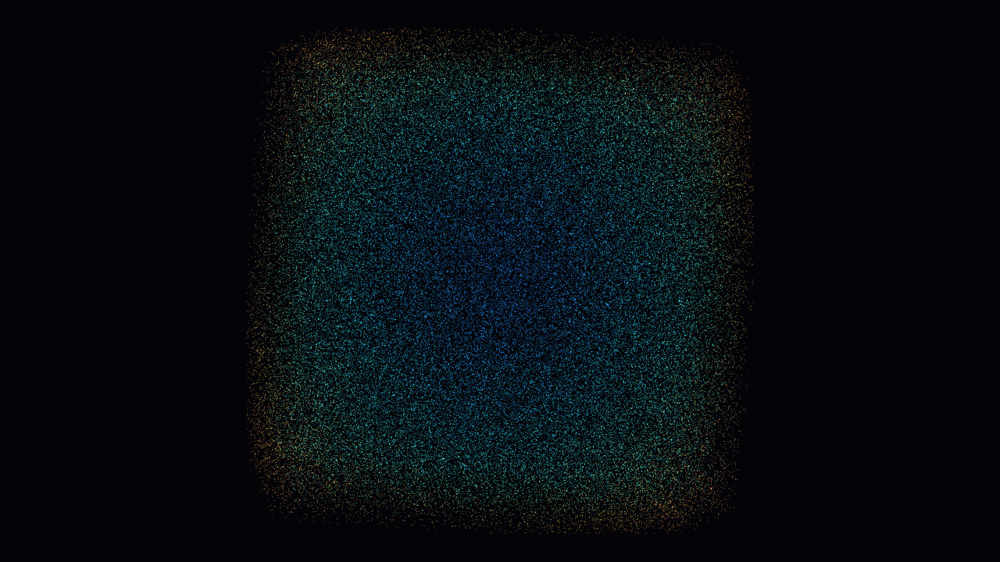
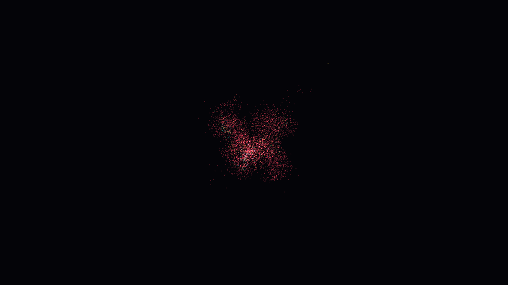

# AetherCompute

GPU-accelerated scientific computing engine in Rust. The same simulations run on
three backends (**scalar CPU**, **Rayon CPU** and **GPU via wgpu / WGSL, Metal on
macOS**), with numerical validation against a CPU reference, reproducible
benchmarks that separate compute from readback, and a native interactive viewer.

Developed and benchmarked on an Apple M2 (16 GB, macOS 26.4.1). The GPU backend targets
Metal through wgpu; see [Platform support](#platform-support).

| Heat diffusion (512², GPU) | 100,000 particles (GPU) | All-pairs N-body (4,096, GPU) |
|---|---|---|
|  |  |  |

*Rendered offscreen by `aether render` on the M2 (straight from the simulation's GPU buffers).*

## Highlights

* **Three workloads**: O(N) local-force particle dynamics (high-scale baseline), exact O(N²) softened
  all-pairs N-body (small-N, clearly labelled), and explicit 5-point heat diffusion (Dirichlet / Neumann,
  stability-checked).
* **Correctness first**: every benchmark row is validated against the scalar CPU reference before it is
  timed; a fast but wrong kernel exits non-zero. Rayon is bit-identical to scalar; GPU error is reported as
  max-abs / RMS / relative (observed max-abs ≤ 4.8e-7 across all published runs).
* **Rigorous benchmarks**: warm-up and cold start recorded separately; compute, readback and end-to-end timed
  separately; GPU execution time from timestamp queries alongside host wall-clock time; every sample starts from
  identical state (`reset` mode) and the final state is re-validated; backend order is randomised per run; medians
  with bootstrap confidence intervals, p95/p99 and drift diagnostics; raw samples, hardware, git SHA and the exact
  command line stored in every report; speed-up against **both** scalar and Rayon baselines.
* **Regression tooling**: `aether compare` aggregates repeated runs and flags statistically supported
  regressions between a baseline and a candidate, with Markdown and JSON output for CI.
* **Tuned and measured**: WGSL `override` workgroup sizes (64/128/256 sweep) and an experiment showing that
  batching steps into one compute pass cuts small-problem GPU time by up to 13x (details below).
* **Graceful degradation**: no GPU adapter, limits exceeded or invalid config give clear errors; CPU backends
  keep working.
* **136 automated tests** (unit, property-style invariants, scalar-vs-Rayon and CPU-vs-GPU differential tests).

## Platform support

| Platform | Status |
|---|---|
| macOS, Apple Silicon (Metal) | Supported. All GPU tests and benchmarks run here. |
| CPU backends (scalar, Rayon) on macOS and Linux | Supported and covered by CI. |
| GPU on Linux (Vulkan) and Windows (DX12/Vulkan) | Expected to work through wgpu, but not yet tested. |

The GPU code is written in WGSL against wgpu, so it is vendor-neutral. It does not use CUDA, and
there is no NVIDIA-specific path.

## Quick start (Apple Silicon Mac)

```bash
xcode-select --install                                   # Command Line Tools (full Xcode optional)
curl --proto '=https' --tlsv1.2 -sSf https://sh.rustup.rs | sh
git clone https://github.com/hfmohammed/aethercompute && cd aethercompute
cargo build --release -p aether-cli                      # binary: target/release/aether

target/release/aether info                               # adapter, backend, limits, features
target/release/aether validate -w heat --size 256 --seed 42 --steps 50
target/release/aether viewer -w particles-local --count 100000   # interactive demo
```

One-command demo (build, validate everything, benchmark a heat sweep, open the viewer):

```bash
./scripts/demo.sh
```

## CLI

```
aether info      [--json] [--require-gpu]
aether validate  -w <workload> --size N --steps N --seed N [--backend rayon,gpu] [--require-gpu]
aether bench     -w <workload> --count|--grid|--size N[,N...] --steps N --warmup N --repeats N
                 [--backend all|scalar,rayon,gpu] [--workgroup-sweep 64,128,256] [--pass-mode per-step|batched]
                 [-o results.json] [--csv results.csv] [--plot-dir docs/img] [--require-gpu]
aether viewer    -w <workload> --count|--grid N ...
aether render    -w <workload> -o frame.png --warm-steps N [--width W --height H]
aether compare   run1.json run2.json run3.json [--baseline base1.json base2.json base3.json]
                 [--metric compute|device|gap|readback|end-to-end] [--threshold 0.10]
                 [--markdown out.md] [--json out.json]
aether plot      results.json -o docs/img
```

`bench` also takes `--bench-mode reset|continuous`, `--order-seed N`, `--cooldown-ms N`,
`--no-shuffle` and `--require-gpu-timestamps`; see [docs/benchmarking.md](docs/benchmarking.md).

Workloads: `particles-local`, `nbody-allpairs`, `heat`. Any command also takes `--config configs/x.json`
(see [configs/](configs)), `--seed`, `--dt`, `--force-scale`, `--softening`, `--damping`, `--workgroup`,
`--boundary dirichlet|neumann`, `--diffusion-number`. Exit codes: `0` ok, `1` error (e.g. missing required
GPU), `2` failed numerical validation.

### Viewer controls

`space` pause · `+`/`-` steps per frame · `R` reset · drag to pan · scroll to zoom · `0` reset view ·
`[` `]` point size · `S` save PNG · `Esc` quit. The window title shows workload, size, adapter, FPS,
steps/frame and the latency of an isolated synchronised step.

## Measured results

Hardware: Apple M2 (8 logical CPUs), 16 GB, macOS 26.4.1, AC power, release build, rustc 1.97.1,
commit `8c8201e` (clean tree), wgpu 30.0.1 / Metal. Times are medians of 20 measured repeats after 5 warm-up
runs, per sample of 200 steps (20 for N-body). "GPU" is the best of workgroup sizes 64/128/256 for that size;
all three are in the CSV/JSON (they differ by < ~10% except where noted). Raw samples, p95/p99, confidence
intervals and cold-start times: [results/](results). Charts: [docs/img/](docs/img).

> **Methodology.** These tables come from the first benchmark harness (report schema v1, `continuous` mode), in
> which a single simulation keeps evolving across warm-up and all samples, so later samples start from a different
> state (for example, the heat field converges). The current harness defaults to `--bench-mode reset`, where every
> sample starts from identical state, and a preliminary run in that mode showed lower GPU speed-ups (for example
> about 11x vs scalar for heat 1024², compared with 31x below). Treat the speed-ups below as upper-end figures
> until they are replaced by a three-run `reset`-mode sweep (`./scripts/bench.sh`, aggregated with `aether compare`).

### Particles, local update (O(N)), 200 steps/sample

| size | scalar (ms) | Rayon (ms) | GPU (ms, best wg) | GPU vs scalar | GPU vs Rayon | GPU vs Rayon end-to-end | GPU M updates/s | max abs err (GPU vs CPU) |
|---|---|---|---|---|---|---|---|---|
| 1,000 | 0.76 | 6.38 | 1.16 (wg 64) | 0.7x | 5.5x | 4.6x | 173 | 2.5e-07 |
| 10,000 | 5.81 | 9.54 | 0.80 (wg 256) | 7.3x | 11.9x | 9.5x | 2,503 | 2.5e-07 |
| 100,000 | 65.03 | 28.11 | 8.73 (wg 256) | 7.5x | 3.2x | 3.0x | 2,292 | 3.6e-07 |

### Heat diffusion (5-point, Dirichlet boundary), 200 steps/sample

| size | scalar (ms) | Rayon (ms) | GPU (ms, best wg) | GPU vs scalar | GPU vs Rayon | GPU vs Rayon end-to-end | GPU M updates/s | max abs err (GPU vs CPU) |
|---|---|---|---|---|---|---|---|---|
| 256² | 31.03 | 12.13 | 1.55 (wg 256) | 20.0x | 7.8x | 6.8x | 8,441 | 2.4e-07 |
| 512² | 119.36 | 28.27 | 4.61 (wg 128) | 25.9x | 6.1x | 5.7x | 11,369 | 3.6e-07 |
| 1024² | 488.56 | 109.98 | 15.60 (wg 256) | 31.3x | 7.1x | 6.8x | 13,443 | 4.8e-07 |

### All-pairs N-body (O(N²)), 20 steps/sample

| size | scalar (ms) | Rayon (ms) | GPU (ms, best wg) | GPU vs scalar | GPU vs Rayon | GPU vs Rayon end-to-end | GPU M updates/s | max abs err (GPU vs CPU) |
|---|---|---|---|---|---|---|---|---|
| 256 | 1.23 | 0.81 | 1.07 (wg 64) | 1.2x | 0.8x | 0.6x | 5 | 4.5e-08 |
| 1,024 | 19.24 | 4.60 | 3.59 (wg 64) | 5.4x | 1.3x | 1.2x | 6 | 6.0e-08 |
| 4,096 | 308.74 | 63.13 | 14.68 (wg 64) | 21.0x | 4.3x | 4.2x | 6 | 6.0e-08 |

### Optimisation experiment: one compute pass per step vs one pass per batch

| workload | size | per-step pass (ms / 200 steps) | batched (ms / 200 steps) | speed-up |
|---|---|---|---|---|
| particles-local | 1,000 | 7.47 | 0.57 | 13.2x |
| particles-local | 10,000 | 7.55 | 0.85 | 8.9x |
| particles-local | 100,000 | 12.17 | 9.01 | 1.4x |
| heat | 256² | 7.62 | 1.56 | 4.9x |
| heat | 512² | 9.19 | 4.61 | 2.0x |
| heat | 1024² | 23.94 | 17.78 | 1.3x |

How to read these numbers:

* **Times are host wall-clock**, measured around submit and wait-for-idle, so GPU figures include submission and
  synchronisation overhead. Newer reports also store GPU execution time from timestamp queries as a separate
  series. "Compute" excludes readback; "end-to-end" adds copying the final state back to the host.
* **GPU is not always faster.** At 1,000 particles the scalar CPU is faster than the GPU (0.7x), and at 256
  bodies Rayon beats the GPU. Rayon is also *slower than scalar* at 1,000 particles because fork/join
  overhead dominates tiny loops, so GPU-vs-Rayon there overstates the win; GPU-vs-scalar is the fair baseline at that size.
* The N-body column "M updates/s" counts one body update (each costing N interactions); it must not be compared with
  the O(N) modes.
* Run-to-run variation on this machine is about 10% (compare the 1024² heat GPU rows in the main sweep and the
  experiment). Results apply to this machine and configuration only.

### Optimisation experiment: batching passes

The first benchmark showed a fixed ~36 µs per step on the GPU regardless of problem size (1,000 and 10,000
particles took the same time), i.e. the cost of encoding one compute pass per step. Recording all steps of a
batch as dispatches inside a single compute pass keeps results bit-identical (tested) and removes most of that cost.
`--pass-mode per-step` reproduces the original behaviour; `batched` is now the default. Large problems are
bandwidth/compute bound, so the gain shrinks as size grows. Raw data: [results/experiments/](results/experiments).

## Architecture

```
aether CLI / viewer
      |
ExperimentConfig --(seed)--> deterministic scenarios        crates/aether-core
      |
Workload trait: initialize / step / sync / snapshot / validate
  |-------------------|----------------------|
Scalar CPU          Rayon CPU            wgpu + WGSL       crates/aether-cpu, aether-gpu, shaders/
  |-------------------|----------------------|
Snapshots + error metrics --> benchmark records --> JSON / CSV / SVG   crates/aether-bench
      |
Renderer (reads GPU state buffers directly)                 crates/aether-gpu, aether-viewer
```

* [docs/design.md](docs/design.md): equations, memory layouts, buffer lifetime, GPU execution flow
* [docs/numerics.md](docs/numerics.md): tolerances, stability bound, boundary conditions, tested invariants
* [docs/benchmarking.md](docs/benchmarking.md): timing scope, methodology, reproduction, limitations
* [docs/decisions.md](docs/decisions.md): why Metal/wgpu and not CUDA, and other trade-offs

## Testing

```bash
cargo test --workspace          # 136 tests; GPU tests run on Metal and skip when no adapter exists
cargo clippy --workspace --all-targets -- -D warnings
cargo bench -p aether-cpu       # criterion microbenchmarks of the CPU kernels
```

Coverage: scenario determinism, zero-force/ballistic motion, wall reflection, heat conservation / maximum
principle / stability guard, N-body symmetry / momentum / energy drift, host-vs-WGSL struct layout,
scalar-vs-Rayon equality, CPU-vs-GPU differential tests (1, 2, 31, 63, 64, 65, 127, 1K … 100K particles; 3² … 1024²
grids; workgroup sizes 1-256; both boundary modes; 1,000-step runs), limit/failure handling, benchmark
statistics, JSON/CSV export and offscreen rendering. CI ([.github/workflows/ci.yml](.github/workflows/ci.yml)) runs
fmt, clippy, tests and a CLI smoke test on macOS and Linux, a Rust 1.90 (MSRV) build and a dependency audit.
Hosted runners have no usable GPU, so the GPU tests skip there; [gpu.yml](.github/workflows/gpu.yml) runs them on a
self-hosted Apple Silicon runner.

## Repository layout

```
crates/aether-core    config, workload trait, data models, kernels, validation, statistics
crates/aether-cpu     scalar + Rayon backends, criterion benches
crates/aether-gpu     wgpu context/probe, GPU workload, GPU-side renderer, differential tests
crates/aether-bench   experiment harness, machine metadata, JSON/CSV/SVG export
crates/aether-viewer  winit window, input handling, PNG screenshots
crates/aether-cli     `aether` binary
shaders/              particles_local, nbody_allpairs, heat_step, particle_render, heat_render (WGSL)
configs/              reproducible sample configurations
results/              benchmark reports from the M2 (JSON with all samples, CSV summaries)
scripts/              demo.sh, bench.sh (three-run official benchmark)
docs/                 design, numerics, benchmarking, decisions, images
```

## Limitations and future work

* GPU results are from a single machine (Apple M2, Metal). Other wgpu backends and platforms are untested.
* Time integration is semi-implicit Euler only; velocity Verlet is planned. The all-pairs kernel reads from
  global memory with no workgroup-memory tiling yet.
* The README tables predate the reset-mode harness and will be replaced by a three-run sweep.
* The viewer shows its statistics in the window title rather than an in-window overlay.
* Not a physically accurate fluid solver. CPU and GPU outputs agree within documented tolerances, not bit-for-bit.

## License

MIT
